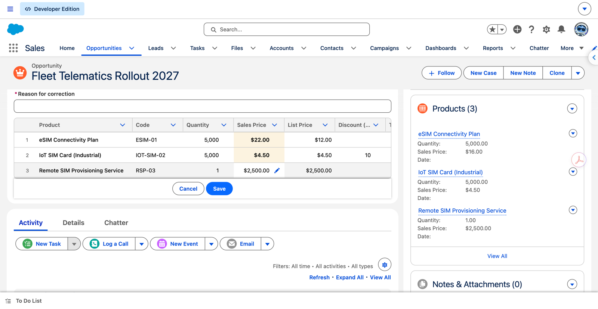
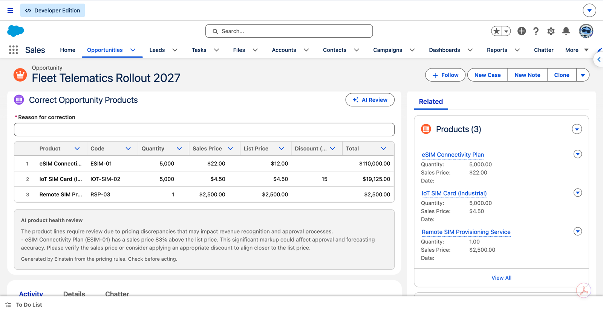

# Opportunity Product Corrector

Fixing products on an Opportunity after the deal is created is a common Sales Ops chore: a wrong quantity, a renegotiated price, a discount in the wrong place. Salesforce lets you edit these values, but it doesn't record why they changed, and it doesn't tell you which lines look wrong in the first place.

So I built a small tool for it. It sits on the Opportunity page, lets you correct quantity, price and discount in one table, asks for a reason, logs every change, and can ask Einstein AI to review the products for pricing problems.

**Stack:** LWC, Apex, SOQL, custom object, validation rules, permission set, Prompt Builder (Agentforce), Jest, GitHub Actions

## How it works

**Correcting products.** Edit the values inline and enter a reason. On save, Apex updates only the fields that actually changed and writes one log record per change (old value, new value, reason, who changed it). If anything fails, for example the validation rule blocking a discount over 50%, the whole save is rolled back and the user sees the rule's message.

| Edit | Reason missing | Saved |
|---|---|---|
|  |  |  |

**AI Review.** I didn't want the AI to do the maths, so the work is split:

1. Apex checks each product against simple pricing rules: price above list, more than 30% below list, discount over 20%, large volume at full list price.
2. A Prompt Builder template receives those findings and writes a short review with one suggested fix per problem. It's told not to invent numbers.
3. The **AI Review** button in the component shows the answer.

This is what it said about my demo opportunity after I raised the eSIM price to $22 (list price $12):

**Security.** All queries and saves run in user mode, so the tool only shows and changes what the user is allowed to. Access comes from one permission set.

## Testing

- 12 Apex tests, with 85–99% coverage per class
- 9 Jest tests for the component
- ESLint and Jest run on every push through GitHub Actions

Running the tests in a real org caught things I wouldn't have guessed:

- Salesforce won't let you change Quantity and Discount together unless you also send the Sales Price, so the code now always includes it.
- The Discount field is hidden by default in a new org. In user mode that shows up as a confusing "No such column" error, so the permission set grants it.
- The retired GPT-3.5 model in the sample templates can't be activated anymore, so the template uses GPT-4.1 mini.

## What's in the repo

- `classes/`: the correction logic, the AI pricing rules, the AI controller, and their tests
- `lwc/opportunityProductCorrector/`: the component and its Jest tests
- `objects/`: the correction log object and the validation rules
- `genAiPromptTemplates/`: the AI review prompt
- `scripts/apex/seed.apex`: demo data (an IoT/eSIM opportunity)
