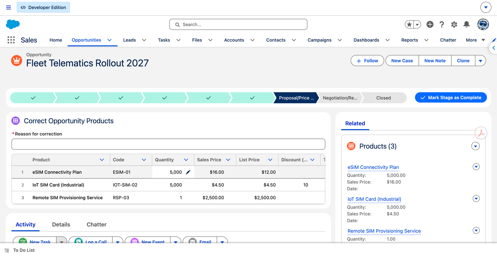
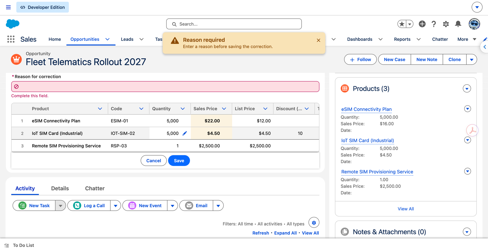
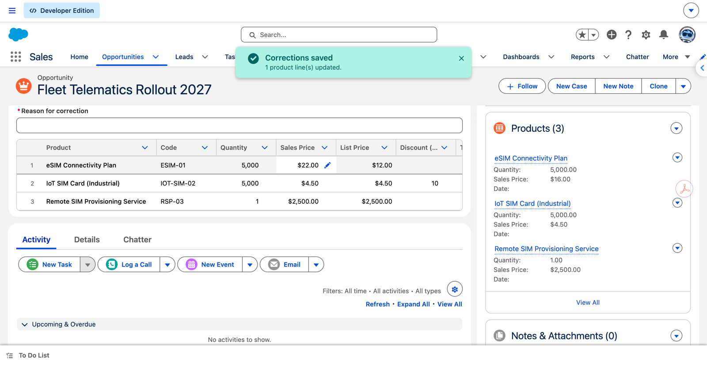

# Opportunity Product Corrector with AI Review

A Salesforce app for **updating and correcting products on existing Opportunities**. Sales Ops can fix quantities, prices and discounts in one table. Every change needs a reason and is logged, and an **Einstein AI review** checks the products for pricing problems and suggests corrections.


Built with Lightning Web Components, Apex, SOQL, custom objects, validation rules, a permission set and an Agentforce Prompt Builder template. Deployed and tested in a Salesforce Developer Edition org.



## The business problem

After a deal is created, its products often need correcting: a wrong quantity, a renegotiated price, or a discount entered in the wrong field. The standard "Edit Products" screen allows edits, but it doesn't:

- ask **why** a value was changed,
- keep an **audit trail** that can be reported on,
- stop out-of-policy discounts before they reach the forecast,
- point out **which lines look wrong** in the first place.

## What it does

| | Feature | How |
|---|---|---|
| ✏️ | Inline correction of Quantity, Sales Price and Discount | LWC `lightning-datatable` with inline edit on the Opportunity record page |
| 📝 | Required reason for every correction | Checked in the component and again in Apex |
| 🧾 | Audit log, one row per changed field (old value, new value, reason, user) | Custom object `Product_Correction_Log__c`, reportable |
| 🛡️ | Business rules: discount ≤ 50%, quantity > 0 | Validation rules on `OpportunityLineItem`; the rule's message is shown to the user |
| ↩️ | All or nothing: line items and log rows are saved together | Apex savepoint and rollback |
| 🔐 | Respects the user's permissions | All SOQL and DML in **user mode**; access through the `Product_Correction_Access` permission set |
| ✨ | **AI Review** of the product lines | Prompt Builder template grounded by Apex pricing rules, called from the LWC |

### Inline edit, required reason, and save

| Editing sales prices | Reason is required | Saved |
|---|---|---|
|  |  |  |

## AI Review: how the AI part works

The AI is used for **data analysis and decision support**, not for doing the calculations itself.

1. **Apex finds the facts.** `ProductHealthGrounding` reads the Opportunity's products and applies fixed pricing rules: price above list, price more than 30% below list, discount above 20%, and large volume at full list price.
2. **The prompt template explains them.** `Opportunity_Product_Health_Review` (Prompt Builder, Flex template) gets these facts through Apex grounding. It asks the model for a short review with one concrete correction per flagged line, and forbids inventing numbers.
3. **The LWC shows the result.** The **AI Review** button calls `ProductHealthAIController`, which runs the template through `ConnectApi.EinsteinLLM`.

Because the calculations happen in Apex, the flags are tested and repeatable. The model only explains and prioritises them.

Example output for the demo opportunity, after the eSIM sales price was changed to $22 against a $12 list price:

> The product lines require review due to pricing inconsistencies that may impact revenue accuracy and approval processes.
>
> - eSIM Connectivity Plan (ESIM-01): The sales price is 83% above the list price, which could lead to approval delays and revenue recognition issues. Please verify the sales price or consider applying a discount to align more closely with the list price.

## Architecture

```
Opportunity record page
└─ opportunityProductCorrector (LWC)
   ├─ @wire getLineItems ─────────────► OpportunityProductController ── SOQL WITH USER_MODE
   ├─ saveCorrections(drafts, reason) ► OpportunityProductController
   │                                     ├─ update as user OpportunityLineItem ◄── validation rules
   │                                     └─ insert as user Product_Correction_Log__c
   └─ AI Review ──────────────────────► ProductHealthAIController
                                         └─ Prompt template Opportunity_Product_Health_Review
                                              └─ grounding: ProductHealthGrounding (pricing rules)
```

## Testing

| Layer | Tests | Result |
|---|---|---|
| Apex: `OpportunityProductControllerTest` | Load, save with audit rows, skip unchanged values, required reason, rollback on validation rule | 6 passing, **94%** coverage |
| Apex: `ProductHealthTest` | Each pricing rule, grounding text, template input, AI error handling | 6 passing, **99%** grounding / **85%** AI controller |
| LWC Jest | Rendering, empty and error states, reason check, number conversion, toasts, record refresh, AI review | 9 passing |
| CI | GitHub Actions runs ESLint and Jest on every push | ✅ |

Generative AI calls can't run inside Apex tests, so the controller skips only the one real AI call in tests. Building the template input and handling errors are still tested.

## Platform details found while testing in a real org

- **Quantity and Discount can't change together without Sales Price.** Salesforce rejects such an update because it can't work out the total. The controller always sends the current Sales Price when a line changes.
- **The Opportunity Product `Discount` field is hidden in new orgs.** In user mode, a hidden field causes a "No such column" error, so the permission set grants it explicitly.
- **Picklists sort in their defined order, not alphabetically.** Tests look up log rows by field name instead of by position.
- **Prompt templates need an active model.** The retired GPT-3.5 default couldn't be activated, so the template uses `sfdc_ai__DefaultGPT41Mini`.

## Setup

Needs a Developer Edition org with Einstein generative AI (Prompt Builder) enabled.

```bash
npm install

sf org login web --alias my-org --set-default
sf project deploy start --manifest manifest/package.xml --test-level RunLocalTests
sf org assign permset --name Product_Correction_Access

# Demo data: an IoT/eSIM opportunity with three products
sf apex run --file scripts/apex/seed.apex
```

Then open the Opportunity, choose ⚙️ → **Edit Page**, drag **Opportunity Product Corrector** onto the page, and **Save** → **Activate**.

## Commands

| Task | Command |
|---|---|
| Run all Apex tests with coverage | `sf apex run test --test-level RunLocalTests --code-coverage --result-format human --wait 10` |
| Run one Apex test method | `sf apex run test --tests OpportunityProductControllerTest.saveCorrectionsRequiresReason --result-format human --wait 10` |
| Run LWC Jest tests | `npm run test:unit` |
| Lint LWC | `npm run lint` |
| Validate a deploy without saving | `sf project deploy validate --manifest manifest/package.xml --test-level RunLocalTests` |

## Project structure

```
force-app/main/default/
├── classes/                OpportunityProductController, ProductHealthGrounding,
│                           ProductHealthAIController and their test classes
├── lwc/opportunityProductCorrector/   UI, styles and Jest tests
├── objects/                Product_Correction_Log__c and its fields,
│                           OpportunityLineItem validation rules
├── genAiPromptTemplates/   Opportunity_Product_Health_Review
├── permissionsets/         Product_Correction_Access
└── tabs/                   Product Correction Log tab
manifest/package.xml        Everything to deploy
scripts/apex/seed.apex      Demo data
```

## Next steps

- Record-triggered Flow: create a review Task for the Opportunity owner when a discount above 20% is saved.
- Report and dashboard on corrections by field and by user.
